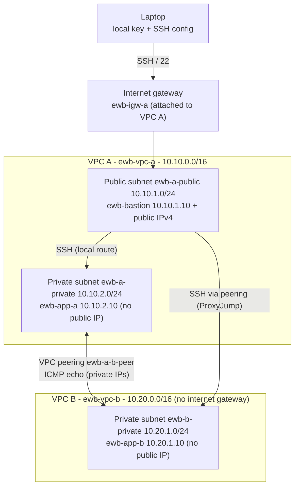

# Architecture

- Administration: laptop > bastion > App-A or App-B (SSH ProxyJump).
- Project traffic: App-A <> App-B over private IPs through the peering connection.
- Peering does not give VPC B internet access through VPC A (no transitive routing, no edge-to-edge routing via IGW).

## Address plan
| Resource | Where | CIDR / address |
|---|---|---|
| ewb-vpc-a | VPC A | 10.10.0.0/16 |
| ewb-a-public | VPC A | 10.10.1.0/24 |
| ewb-a-private | VPC A | 10.10.2.0/24 |
| ewb-vpc-b | VPC B | 10.20.0.0/16 |
| ewb-b-private | VPC B | 10.20.1.0/24 |
| ewb-bastion | ewb-a-public | 10.10.1.10 + public IPv4 |
| ewb-app-a | ewb-a-private | 10.10.2.10, no public IP |
| ewb-app-b | ewb-b-private | 10.20.1.10, no public IP |

The two VPC CIDRs do not overlap, which is a requirement for peering.
